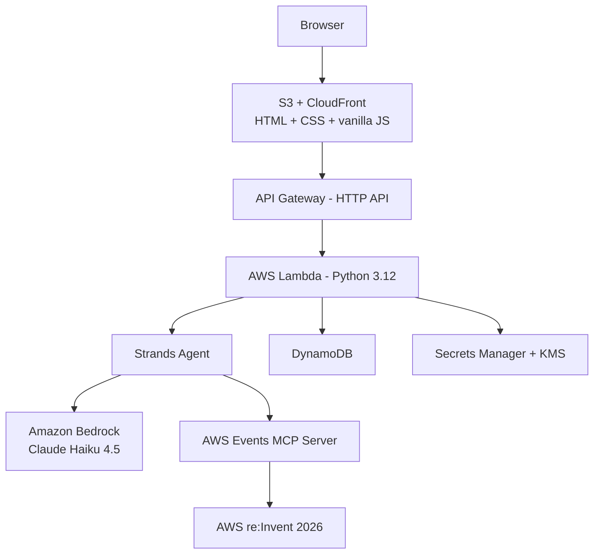

# AWS re:Invent 2026 Session Assistant

A personal, AI-assisted assistant for exploring AWS re:Invent 2026 sessions in
natural language. Ask a question, get real sessions back, then favorite them,
reserve seats, and plan your week, all from one chat-style web page.

It is built on a fully serverless AWS stack and uses an AI agent (Strands
Agents on Amazon Bedrock) that calls the **AWS Events MCP Server** for all
session data. The app never invents sessions and keeps no fake local favorites.

> **Single-user by design.** This is a personal app wired to one AWS Events
> identity. It is not multi-user SaaS: there are no sign-ups, no user accounts
> and no user directory.

## Live demo

Try the interface in your browser, with no sign-in and no AWS account:
**[Open the live demo](https://bhatiagirish.github.io/re-Invent-2026-Session-AI-Assistant-public/demo/index.html)**

The demo runs the real front-end code against about twenty **fictional**
sample sessions, so you can click through search, details, favorites,
reservations, the schedule view and personal time. A few things to know:

- It uses a simple keyword matcher instead of the AI agent, so it understands
  far fewer phrasings than the real app, which uses Amazon Bedrock and live data
  from the AWS Events MCP Server.
- No requests go to AWS. Changes live in your browser tab and reset when you
  reload (or press **Reset demo**).
- Sessions, rooms and speakers are made up and are not the real re:Invent catalog.

Things to try: "Find Kiro sessions", "Tell me more about #1", "Favorite #2",
"Reserve a seat for DVT201", "Show my schedule for 2026-12-02", and
"Add lunch Dec 1 noon to 1pm".

## What you can do

Ask in plain language, or use the buttons on each session card.

| Capability | Examples |
|---|---|
| Search sessions | "Find sessions about Amazon Bedrock", "Beginner serverless workshops" |
| Session details | "Tell me more about #2" |
| Count and group | "How many sessions about Kiro are on Dec 3?", "Count workshops by venue" |
| Favorites | "Favorite #2", "Unfavorite it", "Show my favorites" (star button on cards) |
| Reservations | "Reserve #3", "Cancel that reservation" (Reserve button on cards, "My Reservations" view) |
| Schedule | "Show my schedule" (reserved sessions, favorites and personal time in one ordered list, Pacific time) |
| Personal time | "Add lunch Dec 1 noon to 1pm", "Move my 3pm block to 4pm", "Delete that block" (also a form in the schedule view) |
| Follow-ups | "How many of those are workshops?" (the assistant remembers earlier turns) |

Other frontend features:
- Dark theme by default, with a one-click dark/light toggle remembered per browser.
- Responses can contain Markdown, rendered safely (no raw HTML injection).
- A favorite is a bookmark. A reservation is a held seat. The app keeps the two
  distinct and only reports success when AWS Events confirms it.

## How it works



1. You type a question in the browser. The page calls `POST /chat` on the
   backend. The browser never talks to Bedrock or the MCP server directly.
2. API Gateway invokes a Lambda function, which builds a Strands agent bound to
   your authenticated AWS Events session and runs one conversation turn.
3. The agent sends your message to Claude on Amazon Bedrock. The model decides
   which tool to call; there is no hard-coded keyword mapping.
4. Tools call the AWS Events MCP Server, the single source of truth for session
   data, favorites, schedule, personal time and reservations.
5. The backend returns a natural-language message **plus** a structured list of
   sessions taken from real MCP results, never parsed out of the model's text.
   The UI renders the cards from that structured list.

### Agent tools

| Tool | Purpose |
|---|---|
| `search_sessions` | Find sessions by topic, level, type or date |
| `get_session_details` | Full details for one session (resolves "#2" references) |
| `count_sessions` | Counts across the catalog, favorites or reservations, grouped by date, venue, topic or type |
| `favorite_session`, `unfavorite_session`, `show_favorites` | Manage favorites |
| `show_schedule`, `find_schedule_conflicts` | View the schedule and detect overlaps |
| `add_personal_time`, `update_personal_time`, `delete_personal_time` | Manage personal calendar blocks |
| `reserve_session`, `cancel_reservation` | Manage seat reservations (only when reservations are enabled) |

### Conversation memory

Each conversation is multi-turn. A compact, text-only history is stored in
DynamoDB and replayed into the agent, so follow-ups keep their context. History
is bounded for cost and latency and expires automatically (DynamoDB TTL).

### Time zones

You enter times in Pacific (Las Vegas) time. The backend converts them to the
AWS Events format (UTC, `YYYY-MM-DDTHH:MM:SS`, 5-minute granularity) using real
IANA time zone rules, and validates input before any MCP call.

## AI model

| Item | Value |
|---|---|
| Model | Anthropic Claude Haiku 4.5 on Amazon Bedrock |
| Model ID | `us.anthropic.claude-haiku-4-5-20251001-v1:0` (cross-region inference profile) |
| Agent framework | [Strands Agents](https://strandsagents.com) |
| Tool protocol | Model Context Protocol (MCP) |
| Override | Set the `BedrockModelId` stack parameter |

## AWS services used

| Service | Role |
|---|---|
| Amazon S3 + CloudFront | Hosts the static frontend (private bucket, Origin Access Control, HTTPS) |
| Amazon API Gateway (HTTP API) | Front door for the backend, routed under the same CloudFront domain |
| AWS Lambda (Python 3.12, arm64) | Backend routing, auth and agent orchestration |
| Amazon Bedrock | Claude Haiku 4.5 for natural-language understanding |
| Amazon DynamoDB | App session, conversation context and history (TTL-expired) |
| AWS Secrets Manager | Admin key and server-side refresh token |
| AWS KMS | Encrypts cached access tokens |
| Amazon CloudWatch | Structured logs (tokens are never logged) |
| AWS SAM / CloudFormation | Infrastructure as code (`infra/template.yaml`) |

External dependency: the **AWS Events MCP Server** (`https://api.awsevents.com/mcp`).

## Security model

- AWS Events publishes a loopback-only native OAuth client, so a hosted browser
  sign-in is not possible. This app uses a local "connect" step instead: you
  sign in once on your own machine and the token is pushed to the backend.
- Tokens are stored server-side only (KMS-encrypted). The browser holds just an
  opaque `HttpOnly; Secure; SameSite` session cookie and never sees a token.
- State-changing requests require the session cookie and a CSRF token.
- CORS is restricted to the CloudFront origin, and IAM is least-privilege
  (one table, one KMS key, scoped secrets, `bedrock:InvokeModel`).

## Project structure

```text
backend/    Lambda code: app, agent, MCP client, favorites, schedule,
            reservations, session manager, auth, models, config
frontend/   Static site: HTML, CSS and vanilla JavaScript (no build step)
infra/      template.yaml (AWS SAM)
```

## Build and deploy

### Prerequisites

- An AWS account and credentials that can create the stack's resources
- [AWS CLI v2](https://docs.aws.amazon.com/cli/latest/userguide/getting-started-install.html)
  and [AWS SAM CLI](https://docs.aws.amazon.com/serverless-application-model/latest/developerguide/install-sam-cli.html)
- Python 3.12 with `pip` (SAM builds the Lambda package with it)
- **Amazon Bedrock model access** for Claude Haiku 4.5 enabled in `us-east-1`
- An AWS Events identity (AWS Builder ID) registered for re:Invent 2026

Use `us-east-1` for everything below, regardless of your CLI default region.

```bash
export AWS_REGION=us-east-1
export AWS_DEFAULT_REGION=us-east-1
STACK=reinvent-session-assistant
```

### 1. Create a Python 3.12 environment

```bash
python3.12 -m venv .venv
source .venv/bin/activate
pip install -r backend/requirements.txt
```

### 2. Build

```bash
sam build -t infra/template.yaml
```

### 3. Deploy the stack (pass 1)

CloudFront does not exist until the first deploy, so the first pass uses a
placeholder redirect URI.

```bash
sam deploy \
  --stack-name "$STACK" \
  --region "$AWS_REGION" \
  --resolve-s3 \
  --capabilities CAPABILITY_IAM \
  --no-fail-on-empty-changeset \
  --parameter-overrides \
    OAuthRedirectUri="https://placeholder.invalid/auth/callback" \
    ReservationsEnabled="true"
```

Read the stack outputs:

```bash
out() { aws cloudformation describe-stacks --stack-name "$STACK" --region "$AWS_REGION" \
  --query "Stacks[0].Outputs[?OutputKey=='$1'].OutputValue" --output text; }

API_URL="$(out ApiBaseUrl)"
SITE_URL="$(out FrontendUrl)"
BUCKET="$(out FrontendBucketName)"
echo "$API_URL" "$SITE_URL" "$BUCKET"
```

### 4. Deploy again (pass 2)

Now that the CloudFront domain exists, set it for CORS and the redirect URI.

```bash
sam deploy \
  --stack-name "$STACK" \
  --region "$AWS_REGION" \
  --resolve-s3 \
  --capabilities CAPABILITY_IAM \
  --no-fail-on-empty-changeset \
  --parameter-overrides \
    FrontendOrigin="$SITE_URL" \
    OAuthRedirectUri="$SITE_URL/auth/callback" \
    ReservationsEnabled="true"
```

Set `ReservationsEnabled="false"` to turn the reservation feature off.

### 5. Upload the frontend

`frontend/config.js` ships with `API_BASE_URL: ""`, which keeps the site and API
on the same CloudFront domain. No edit is needed.

```bash
aws s3 sync frontend "s3://$BUCKET/" --delete --region "$AWS_REGION"

DOMAIN="${SITE_URL#https://}"
DIST_ID="$(aws cloudfront list-distributions \
  --query "DistributionList.Items[?DomainName=='$DOMAIN'].Id | [0]" --output text)"
aws cloudfront create-invalidation --distribution-id "$DIST_ID" --paths '/*'
```

## Run the solution

The site needs a one-time local sign-in to link your AWS Events identity to the
backend. The session lasts about an hour; repeat this step to reconnect.

1. Quit any other AWS Events MCP client first (the sign-in uses local port `8976`).
2. Read the admin key from Secrets Manager and run the connect helper:

```bash
source .venv/bin/activate

ADMIN_ARN="$(out AdminKeySecretArn)"
export APP_API_BASE_URL="$API_URL"
export APP_SITE_URL="$SITE_URL"
export APP_ADMIN_KEY="$(aws secretsmanager get-secret-value --secret-id "$ADMIN_ARN" \
  --region "$AWS_REGION" --query SecretString --output text \
  | python3 -c 'import sys,json; print(json.load(sys.stdin)["admin_key"])')"

python docs/spikes/connect.py
```

3. Your browser opens for AWS Builder ID sign-in. The helper then prints a
   one-time link of the form `https://<your-cloudfront-domain>/#connect=<code>`.
4. Open that link within about two minutes. The page shows **Connected**.
5. Start asking: "Find sessions about Bedrock", "Favorite #2", "Show my schedule".

If the page shows "not authorized", the identity you signed in with is not
registered for re:Invent 2026.

## Tear down

Remove everything and stop costs. The S3 bucket must be emptied before the
stack can be deleted.

```bash
source .venv/bin/activate
export AWS_REGION=us-east-1
STACK=reinvent-session-assistant

# 1. Empty the frontend bucket
BUCKET="$(aws cloudformation describe-stacks --stack-name "$STACK" --region "$AWS_REGION" \
  --query "Stacks[0].Outputs[?OutputKey=='FrontendBucketName'].OutputValue" --output text)"
aws s3 rm "s3://$BUCKET" --recursive --region "$AWS_REGION"

# 2. Delete the stack (CloudFront can take 15-20 minutes)
sam delete --stack-name "$STACK" --region "$AWS_REGION" --no-prompts

# 3. Remove secrets the app created at runtime (not managed by the stack)
for s in $(aws secretsmanager list-secrets --region "$AWS_REGION" \
  --query "SecretList[?starts_with(Name, 'reinvent-assistant/refresh/')].Name" --output text); do
  aws secretsmanager delete-secret --secret-id "$s" \
    --force-delete-without-recovery --region "$AWS_REGION"
done
```

Verify the stack is gone (this should return an error saying it does not exist):

```bash
aws cloudformation describe-stacks --stack-name "$STACK" --region "$AWS_REGION"
```

The KMS key is scheduled for deletion with a waiting period (about 7 to 30 days)
by AWS design, at a cost of cents.


## Limitations

- Single user only; one AWS Events identity per deployment.
- The app session lasts about an hour (token lifetime); reconnect as needed.
- Session data comes entirely from the AWS Events MCP Server. If the 2026
  catalog is empty or inactive, searches return nothing and the "My
  Reservations" list can appear empty even when seats are held, because
  reserved IDs that cannot be resolved to session details are omitted rather
  than fabricated.
